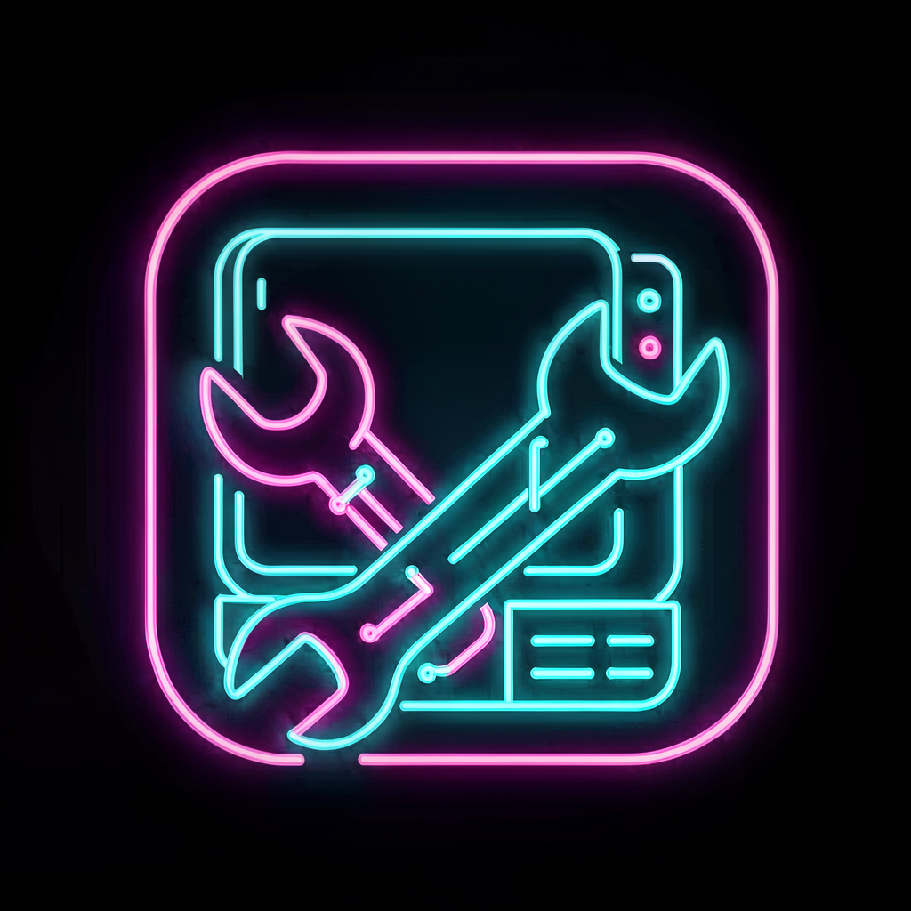
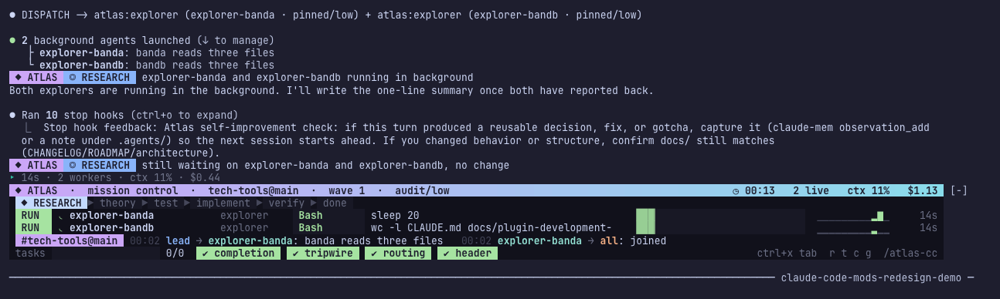
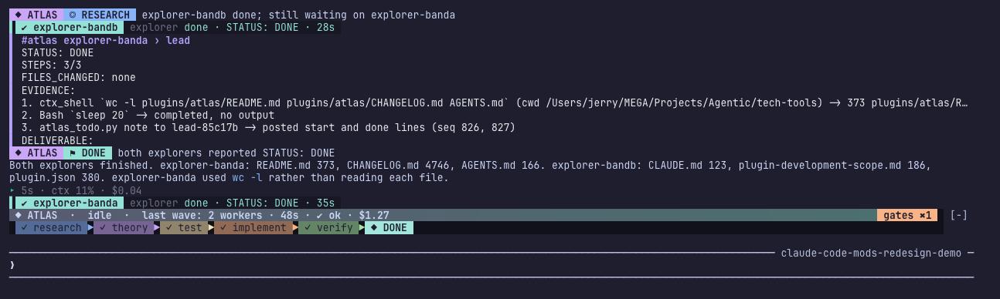
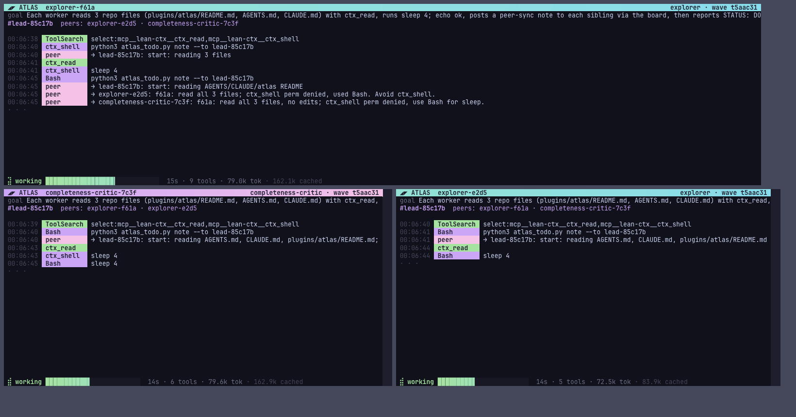
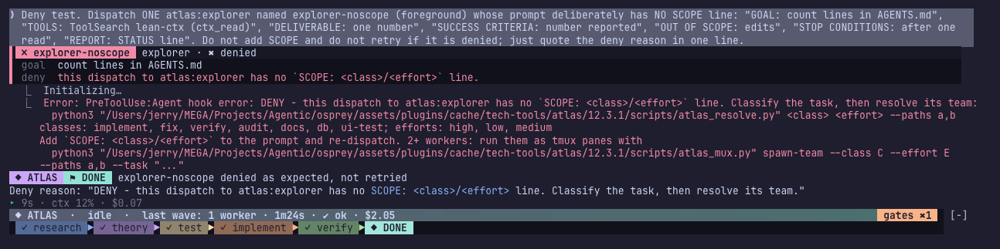
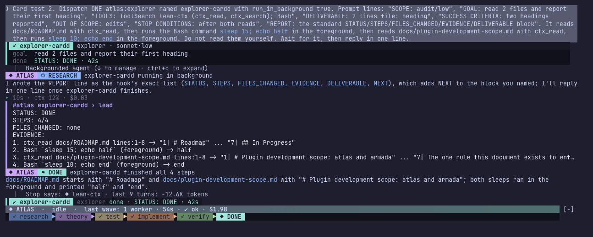
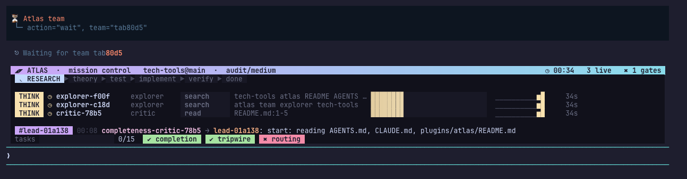
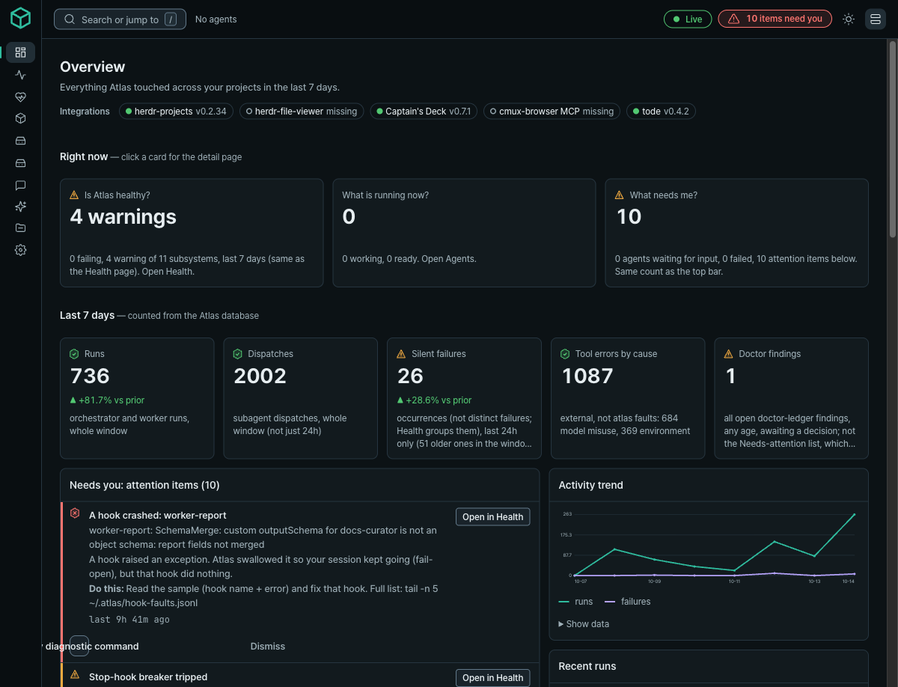
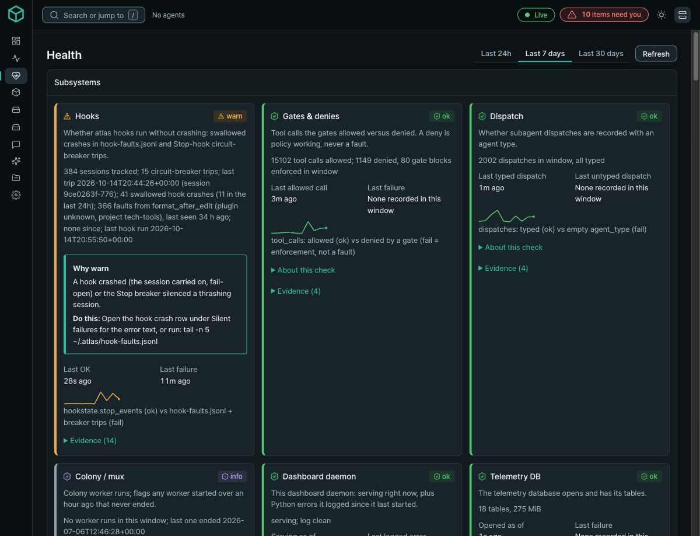
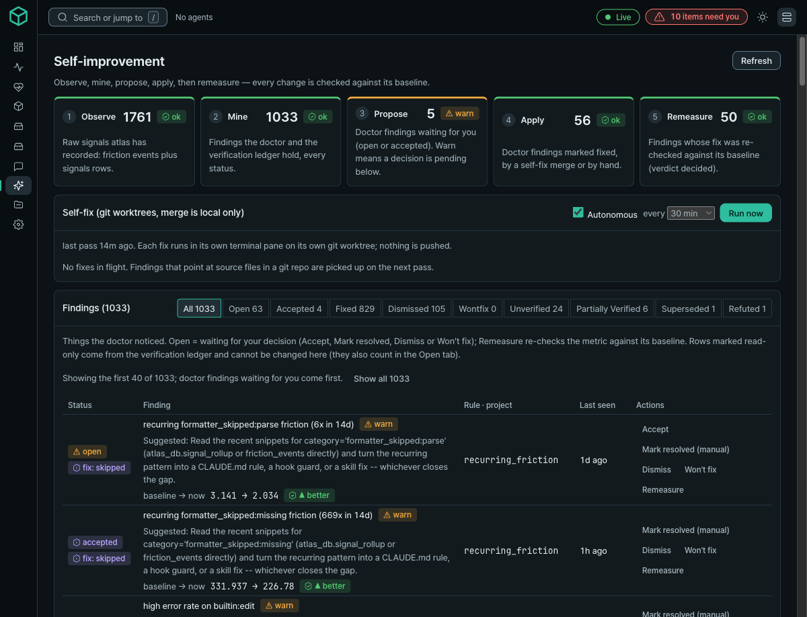

<div align="center">



# Atlas

**A Claude Code and omp plugin that makes a coding agent plan, delegate, verify, and prove its work before it says done.**


</div>

Atlas sits between you and the coding agent. Hooks enforce a fixed
research-to-verify loop, a lead session hands work to named role subagents that
share one board, a Stop gate refuses "done" without evidence, and a doctor mines
the session telemetry so the plugin can tune its own rules. It runs in Claude
Code and, through its extension package, in omp.

Current version: **16.0.1** (`plugins/atlas/.claude-plugin/plugin.json`), a test hermeticity fix on top of 16.0.0. Breaking in 16.0.0: the 13 vendor MCP connectors now ship in the armada plugin (2.0.0); install `armada@tech-tools` to keep them, see [plugins/armada/README.md](plugins/armada/README.md#upgrading-connectors-moved-from-atlas-to-armada). Also in 16.0.0: scoped worker tool profiles, a Stop gate that sees shell-changed files, shared gate rules, one hook process per tool event, and hermetic tests.

Recent changes (full text in [plugins/atlas/CHANGELOG.md](plugins/atlas/CHANGELOG.md)):

- **12.8.0**: omp usage statusline ships with atlas and Claude Code gets a `statusLine` equivalent (`scripts/atlas_statusline.py`); tmux is the intended default colony worker transport when installed, with `claude-bg` as the fallback.
- **12.7.0**: new `sonicwall` connector (SonicOS 7.x REST API, 41 tools, writes staged until a separate commit call).
- **12.6.0**: cost tiering for agents, the Atlas Colony workspace TUI, a single-sourced status header and the codex contract block.
- **12.5.x**: `atlas_herdr ensure` starts the headless herdr server itself; atlas no longer writes `.atlas` into `~` or `~/Downloads`.

| What | Count | Source |
|---|---|---|
| Skills | 39 | `plugins/atlas/skills/` |
| Role agents (`atlas:*`) | 14 | `plugins/atlas/agents/` |
| Hooks | 17 programs, 22 bindings, 9 lifecycle events | `plugins/atlas/hooks/hooks.json` |
| Scripts | 55 non-test Python scripts | `plugins/atlas/scripts/` |
| MCP connectors | 13 (including `panos` and `sonicwall`), each off until credentials exist | `plugins/armada/.mcp.json` (servers in `plugins/armada/mcp/`; shipped by the armada plugin, install atlas and armada together) |
| omp agents | 14, generated | `plugins/atlas/omp/agents/` |

## Contents

1. [What it looks like](#what-it-looks-like)
2. [Quick start](#quick-start)
3. [How it works](#how-it-works)
4. [omp support](#omp-support)
5. [Command Center web UI](#command-center-web-ui)
6. [Configuration](#configuration)
7. [Documentation](#documentation)
8. [Releases](#releases)
9. [Developing atlas](#developing-atlas)
10. [License](#license)

## What it looks like

Every image below is a real capture of the installed plugin, taken from a tmux
session or the browser.

**Mission Control band.** The panel above the prompt shows the wave, phase
pills, one lane per worker with its current tool and target, a channel ticker,
and gate chips.



When the wave ends the band settles into a summary of what ran and which gate
is still open.



**Parallel teams.** Two or more workers run side by side in one tmux window,
each pane headed by its role, with tool and peer chips.



**Gates in the transcript.** A dispatch that breaks a rule is refused with the
command that fixes it. A worker's card updates in place when it reports.




## Quick start

**Install** (Claude Code):

```bash
claude plugin marketplace add w159/tech-tools    # first time only: register the catalog
claude plugin install atlas@tech-tools           # first time only: install the plugin
```

To update later, refresh the catalog and update the plugin:

```bash
claude plugin marketplace update tech-tools
claude plugin update atlas@tech-tools
```

Restart the session afterwards: hooks resolve at session start.

**omp:**

```bash
omp plugin install atlas@tech-tools    # first time (tech-tools is already a configured marketplace if you added it)
omp plugin upgrade atlas               # update
```

**Onboard a project once:**

```text
/atlas-setup
```

`/atlas-setup` checks the companion plugins (claude-mem, context-mode),
scaffolds `docs/` and `.atlas/`, wires hooks, and walks through connectors.

**Then describe the work.** Skills trigger from plain language, or name one:

```text
atlas-orchestrate add CSV export to the reports page
atlas-debug login returns 500
atlas-audit
```

## How it works

### 1. One loop for every task

```text
research -> theory -> test -> validate -> implement -> verify -> done
```

Every reply opens with a status line that names the phase. This is a real one
from a session that fixed the omp advisor gate:

```text
ATLAS | 🏁 done 1/1 | omp advisor gate fixed and its tests pass, not yet run in a live omp session
```

`done` is terminal. It is allowed only when every deliverable exists, nothing
is still running, no question is pending, and no advisor item is open.

### 2. The lead delegates, workers do the work

The lead classifies the task and resolves its team from one scope matrix:

```text
$ python3 plugins/atlas/scripts/atlas_resolve.py implement medium --paths plugins/atlas/omp/advisor.ts
{"effort": "medium", "task_class": "implement", "isolation": "worktree", "max_parallel": 3,
 "team": [{"count": 2, "role": "implementer"}, {"count": 1, "role": "verifier"}]}
```

Then it dispatches named workers. Each dispatch carries a `SCOPE:`, a `TOOLS:`
block, a `GOAL:`, a `DELIVERABLE:`, success criteria, what is out of scope, and
when to stop. A dispatch missing any of them is denied before it runs:

```text
DENY - this Agent dispatch to atlas:implementer is unbounded: missing GOAL:, DELIVERABLE:.
Each block is a line-start `LABEL: text`. Add exactly:
GOAL: <one measurable sentence>
DELIVERABLE: <the exact artifact>
Then re-dispatch.
```

```text
DENY - SCOPE audit/med does not resolve: unknown effort 'med'; known: ['high', 'low', 'medium'].
```

Workers report in a fixed shape, so the lead can check them:

```text
STATUS: DONE
STEPS: 4/4
FILES_CHANGED: plugins/atlas/omp/advisor.ts; plugins/atlas/omp/advisor.test.ts; ...
EVIDENCE:
1. bun test plugins/atlas/omp/advisor.test.ts -> "18 pass / 0 fail / 47 expect() calls"
2. bun test plugins/atlas/omp (whole omp suite) -> "443 pass / 0 fail"
```

The lead does not take a worker's word for it. It re-runs the check on its own
side before it reports. Read-only roles (explorer, verifier, ui-runtime-tester)
cannot edit code, and a verifier always starts from a fresh context.

### 3. The board and the colony channel

Workers share one board (`.atlas/.run/todos.json`) and a channel per lead.
They claim items before working, post a note on start and on finish, and close
items only with evidence:

```bash
python3 plugins/atlas/scripts/atlas_todo.py claim --id t1a7fd052 --owner implementer-advisor-gate
python3 plugins/atlas/scripts/atlas_todo.py complete --id t1a7fd052 --evidence "advisor tests 18 pass 0 fail"
```

The lead sees each note on its next tool call:

```text
[atlas] 2 messages for you from the board:
- from implementer-advisor-gate: starting advisor gate edits
- from implementer-advisor-gate: advisor gate done, omp tests 443 pass
```

### 4. The Stop gate

When the agent tries to finish, `completion_gate.py` checks the definition of
done (conditions a to p: evidence under `.atlas/evidence/`, a verified finding,
current docs, drained todos, a dispatch for any shipped code, and more). If
something is missing it blocks the stop and says what to do:

```text
[atlas] Definition-of-done gate: the following condition(s) are not met:
  (a) No files found under .atlas/evidence/. Capture observed-behavior proof
      (test output, DB read-back, endpoint response, or UI screenshot) there first.
  (o) Phased todo: this run shipped code, but this session's todo items do not
      cover the required phase(s): implement, verify.
```

The full condition list and every kill switch are in the
[reference](docs/reference/atlas-reference.md#the-operating-contract).

### 5. Memory

The first tool call of a session must be one claude-mem recall for the project,
so prior work is found before it is re-derived:

```text
[atlas gate] REQUIRED once per session: your first tool call must be one
claude-mem recall for this project.
```

### 6. Self-improvement with `/atlas-doctor`

The doctor reads the telemetry in `~/.atlas/atlas.db`, mines recurring friction
into findings, asks you to apply, skip or modify each one, applies what you
accept, and records a baseline so the next run can tell whether the change
helped:

```text
$ python3 plugins/atlas/scripts/atlas_doctor.py --mine --json
{"recurring_friction": 9, "colony_adherence": 2, "turn_quality": 8, "verifier_coverage_low": 1, ...}

finding 8834 -> accepted
improvement 101: finding 8834 baseline=4.42 target=4.0 (remeasure after 5 runs)
finding 8834 -> applied
```

The latest runtime audit, built from these logs, is
[docs/audits/2026-10-14_atlas-runtime-audit.md](docs/audits/2026-10-14_atlas-runtime-audit.md).

## omp support

The same rules run in omp through `plugins/atlas/omp/`: the lean-ctx routing,
the recall gate, the output style, the bridged Stop gate, and the dispatch
tripwire. omp has two extras:

- **Advisor gate.** Every advisor note, of any severity, becomes a board item.
  At the start of each prompt the open items are listed in the context, and a
  stop is refused (up to 3 times per prompt) until each is closed with
  evidence.
- **Mission Control widget.** The same band as Claude Code, inside omp's
  widget area.



The parity matrix is in [docs/architecture/atlas-harness-parity.md](docs/architecture/atlas-harness-parity.md).

## Command Center web UI

A loopback-only dashboard (`http://127.0.0.1:7421/`) starts at session start
and is shared by every open terminal. It reads the same telemetry DB, boards and
channels the hooks write.



| Page | What it shows |
|---|---|
| Overview | KPIs, the needs-attention inbox, recent runs |
| Activity | Events by group, filter and live tail |
| Health | Hooks, gates, dispatch, colony, daemon, DB, connectors, memory, doctor |
| Agents | Three lenses: Roster (colony members with send, stop, pause, resume), Supervise, and Board. `#/colony`, `#/board` and `#/supervise` are aliases for them |
| Colony | The roster of the lead and its workers (the Roster lens) |
| Terminal | A seat grid of real terminals, one per colony worker |
| Channels | What agents and you said to each other |
| Improve | Doctor findings: mark fixed, dismiss, remeasure |
| Projects | Pin, mute or hide projects |
| Settings | Five tabs: Dashboard, Behavior, Models, Integrations, Agents. A saved knob applies on the next hook run |




Every route checks the `Host` header, content type, origin and, for mutations,
a per-start token. Details: [docs/architecture/atlas-workboard.md](docs/architecture/atlas-workboard.md).

## Configuration

Every guard has an off switch. Set it in your shell or in
`~/.claude/settings.json` under `env`. The most used:

| Variable | Effect |
|---|---|
| `ATLAS_GATE=off` | Stop gate off |
| `ATLAS_TRIPWIRE_HARD=off` | dispatch and routing denies off |
| `ATLAS_MANDATES=off` | recall gate off |
| `ATLAS_DASHBOARD=off` | no dashboard at session start |
| `ATLAS_ADVISOR_GATE=off` | omp advisor gate off |
| `ATLAS_MODE=solo` | small direct changes on the main thread are acknowledged instead of forced into a dispatch |

The full table, connector setup, colony transport, remote access and
troubleshooting are in the [reference](docs/reference/atlas-reference.md).

Requirements: Python 3 (stdlib only) for hooks and scripts. Optional: Bun for
omp tests, tmux (the intended default colony transport; `claude-bg` is the fallback, herdr is selectable) for pane workers, uv for the Falcon connector.

## Documentation

| Topic | Where |
|---|---|
| Full reference (skills, agents, hooks, scripts, connectors, colony, troubleshooting) | [docs/reference/atlas-reference.md](docs/reference/atlas-reference.md) |
| Colony and seat backends | [docs/architecture/atlas-colony.md](docs/architecture/atlas-colony.md) |
| Dashboard | [docs/architecture/atlas-workboard.md](docs/architecture/atlas-workboard.md) |
| omp parity | [docs/architecture/atlas-harness-parity.md](docs/architecture/atlas-harness-parity.md) |
| Changes | [docs/CHANGELOG.md](docs/CHANGELOG.md), [plugins/atlas/CHANGELOG.md](plugins/atlas/CHANGELOG.md) |
| Plans | [docs/ROADMAP.md](docs/ROADMAP.md) |
| Audits | [docs/audits/](docs/audits/) |

## Releases

Release notes are in the [CHANGELOG](plugins/atlas/CHANGELOG.md) and on
[GitHub Releases](https://github.com/w159/tech-tools/releases). A release
workflow (`.github/workflows/release.yml`) tags each release
`atlas-v<version>` and takes the release body from the matching CHANGELOG
section.

## Developing atlas

This repo is the marketplace source. Edit under `plugins/atlas/` (and
`mcp_servers/`, `mcp_node/` for connectors), never the installed copy under
`~/.claude/plugins/cache/`. A change reaches a session only after it is released
and the plugin is reinstalled.

```bash
python3 -m unittest discover -s plugins/atlas/hooks        # hook tests
python3 -m unittest discover -s plugins/atlas/scripts      # script tests
bun test plugins/atlas/omp                                 # omp extension tests
```

The marketplace also carries two optional plugins: `armada` (org deployment)
and `programmer` (Pragmatic Programmer auditor). Contributor rules are in
[AGENTS.md](AGENTS.md).

## License

Apache-2.0. Author: [w159](https://github.com/w159). Repository:
[github.com/w159/tech-tools](https://github.com/w159/tech-tools).
