<div align="center">


# Atlas

**Atlas makes Claude Code verify its own work: it delegates to named subagents and blocks "done" until there is evidence.**


</div>

Current versions: atlas 17.39.0, armada 2.5.0, programmer 1.0.5 (from each `plugins/<name>/.claude-plugin/plugin.json`). Release history: [atlas](plugins/atlas/CHANGELOG.md), [armada](plugins/armada/CHANGELOG.md), [programmer](plugins/programmer/CHANGELOG.md).

Upgrading from 15.x: the 13 vendor MCP connectors moved to the armada plugin in atlas 16.0.0. Install `armada@tech-tools` to keep them, see [plugins/armada/README.md](plugins/armada/README.md#upgrading-connectors-moved-from-atlas-to-armada).

- **A fixed work loop.** The operating contract asks for research, test, implement, verify. Hooks check that the phase markers, a plan, evidence and a verified finding exist; they do not judge how good the research or the tests were. A lead session hands work to named role subagents (explorer, implementer, verifier and others) that share one todo board.
- **A gate on "done".** A Stop hook blocks a session's stop while an evidence file, a verified finding backed by a hook-written dispatch or team-member record (or a test-runner command that matches a passing one from this session), current docs or drained todos are missing, or, with `ATLAS_DONE_CLAIM=block`, while a done claim contradicts this turn's own tool results (by default the done-claim check only records findings, because no finding kind has enough real positives to block on; held-out: 0 false blocks on 156 genuine claims). It checks 20 conditions, (a) to (s) and (v); it cannot tell whether the evidence is good; `ATLAS_GATE=off` turns the whole gate off, and a few conditions also have their own switch.
- **Memory and self-tuning.** Each session starts with a claude-mem recall, a local dashboard shows runs and gates, and a doctor mines session telemetry into rule changes that you approve.

| What | Count | Source |
|---|---|---|
| Skills | 26 (2 manual) | `plugins/atlas/skills/` |
| Role agents (`atlas:*`) | 11 | `plugins/atlas/agents/` |
| Hooks | 19 programs, 24 bindings, 9 lifecycle events | `plugins/atlas/hooks/hooks.json` |
| Scripts | 78 non-test Python files | `plugins/atlas/scripts/` |
| MCP connectors | 12, each off until credentials exist | `plugins/armada/.mcp.json` (shipped by the optional armada plugin) |
| omp agents | 11, generated | `plugins/atlas/omp/agents/` |

The marketplace also carries `armada` (an optional organization layer: department agents and the vendor connectors) and `programmer` (code review based on The Pragmatic Programmer). Their licenses and contents are listed in [plugins/README.md](plugins/README.md).

## Quick start

**Prerequisites**

- Claude Code.
- Python 3 (standard library only) for the hooks and scripts.
- Node.js, only if you use armada's vendor connectors.
- uv, only for the CrowdStrike Falcon connector.
- Recommended: the claude-mem and context-mode plugins. `/atlas:atlas-setup` checks for them and offers to install them. Atlas runs without them, but the recall gate and the output-size protection depend on them.
- Optional: tmux (to show worker panes), Bun (to run the omp tests).

**Install** (Claude Code):

```bash
claude plugin marketplace add w159/tech-tools    # first time only: register the catalog
claude plugin install atlas@tech-tools           # first time only: install the plugin
claude plugin install armada@tech-tools          # optional: department agents and vendor connectors
```

To update later, refresh the catalog and update the plugin:

```bash
claude plugin marketplace update tech-tools
claude plugin update atlas@tech-tools
```

Restart the session afterwards: hooks resolve at session start. `claude plugin update` alone does not refresh the catalog: it reads the local marketplace clone, so a stale clone reports "already at the latest version". To have Claude Code refresh third-party marketplaces on its own, turn on auto-update (off by default for every non-Anthropic marketplace): `/plugin` > Marketplaces > tech-tools > Enable auto-update. `atlas_doctor.py` check `clone-fresh` warns when the clone is behind GitHub.

**omp** (the oh-my-pi coding agent CLI, which atlas also supports):

```bash
omp plugin install atlas@tech-tools    # first time (tech-tools is already a configured marketplace if you added it)
omp plugin marketplace update tech-tools   # update: refresh the catalog first
omp plugin upgrade atlas               # then upgrade (alone it reads the cached catalog)
```

**Onboard a project once:**

```text
/atlas:atlas-setup
```

`/atlas:atlas-setup` checks the companion plugins, scaffolds `docs/` and `.atlas/` in the project, wires hooks, and walks through connectors. It asks before it installs or changes anything.

**Then describe the work.** Skills trigger from plain language, or name one:

```text
atlas-orchestrate add CSV export to the reports page
atlas-debug login returns 500
atlas-audit
```

Terms used below: a "colony" is the set of named worker subagents a lead session runs together. Colony mode is on by default: workers run as panes in a tmux session when tmux is installed and as background `claude --bg` processes otherwise (`ATLAS_MUX=off` turns it off, `ATLAS_COLONY_TRANSPORT` forces a transport).

## What it looks like

The pictures below are real screenshots of this build (17.34.1). Claude Code (and omp
for the widget) ran the plugin in a tmux pane on a scratch project, `tmux capture-pane`
took the screen, and headless Chrome turned it into PNG; the dashboard pictures are
headless Chrome screenshots of the running Command Center. Each terminal picture is
cropped above the status line. The text of each surface is in
[plugins/atlas/README.md](plugins/atlas/README.md#in-terminal-mod).

**Mission Control band.** The band is the row above the prompt: the `◆ ATLAS` pill,
then the run state (`research 1/6` with a segmented phase bar and a turning spinner
while a run is on, `done 6/6` after it, `idle up 1:26` at rest), a gates pill
(`1 denied` in red, `gates ok` in green) that opens the gates tab, and the tool rate
(`tools` with a spark and a per-minute figure). Wider terminals add hook latency and
context use. The run clock starts at your prompt, never steps back, and stops when
Claude Code reports its turn idle; a closed run has one total, so the band, run
card, side panel and board print the same figure. A run that ends with a failed
worker or a refused stop reads `blocked`, not `idle`, until a new run starts.
`ATLAS_BAND_RICH=1` draws a tall form with the phase rail.

The HUD under the band draws the TODO and SUBAGENTS boxes. TODO rows share the
columns item, state, owner and time; the title carries a done count and a segmented
bar (`2/5 · ×1`). SUBAGENTS is a table with one row per agent: name, role, state, the last action or
result, and time.
Rows that do not fit are counted on one dim summary row inside the box, and a
running or failed row is the last to hide. A run holds its HUD height from the
first frame, so the band keeps its screen row.

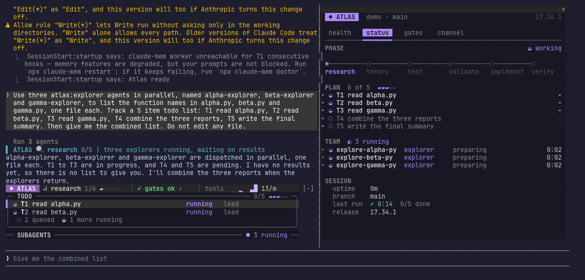

After the workers end the rows read `done` or `failed` and the box titles count
them. The run card (`done 5/5 · 3 workers`) sits in the transcript above the band,
and the status tab lists the plan and the team as done.

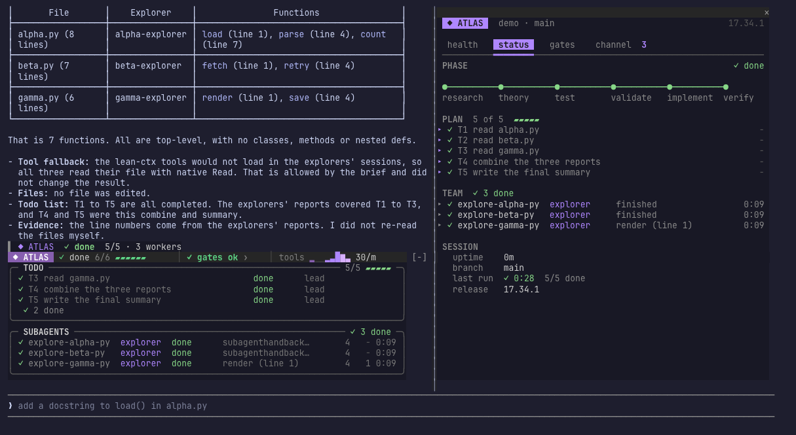

The side panel has four clickable tabs: `health`, `status`, `gates` and `channel`.
`gates` carries its denial count and `channel` its unread count as badges. Every
control is a click; no key letters are printed. The health tab shows the SESSION
state, context use, hook latency, tool rate, denials and a RUNS bar chart. The
status tab shows the PHASE rail (`research theory test validate implement
verify`), the PLAN rows, the TEAM rows and the SESSION facts. The gates tab lists
each gate with a pass or deny mark, the DENIED cards with the fix command, and a
TIMELINE with one tick per gate check. The channel tab is the chat with the lead
and the workers, with a composer and recipient chips at the bottom. The panel
never says `done` while a dispatch is open or a worker runs. The transcript gets
one-row cards: a finish card per worker, one run card per clean run, and one
blocked card per blocked spell.

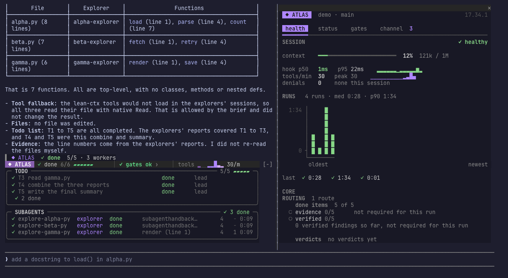

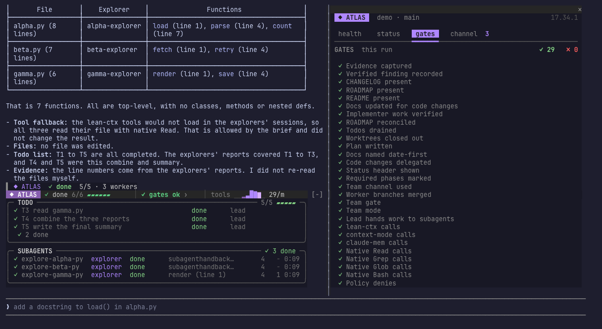

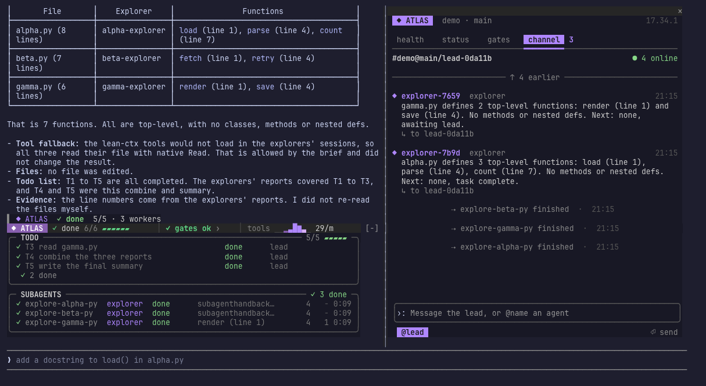

An idle session shows live health instead of an empty band: the band reads
`idle up 1:26 | gates ok | tools 0/m`, and the status tab shows the phase rail, the
last run and the release. The side panel stays docked at 110 columns, where the
phase rail wraps to two lines.

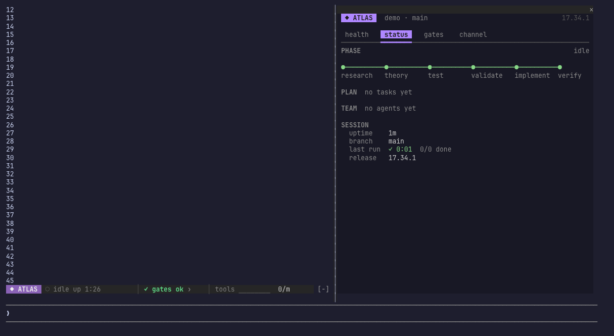

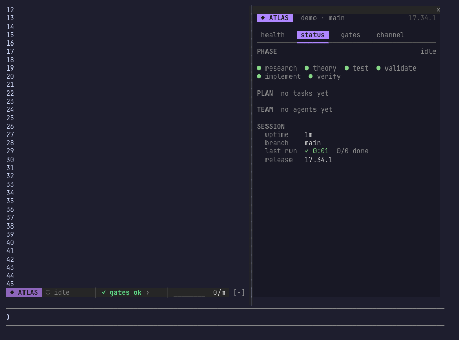

A small history (last 50 runs, hook latency) is kept in `.atlas/.run/history.json`,
so a returning project shows its last run and median at idle.

In paired scoring against btop and htop the mods reach a mean of 5.33 in a fresh
session and 5.75 with history, against 7.75 for btop; the target of 8 was not met
([audit](docs/audits/2026-11-15_atlas-mods-expert-rounds.md)). The scoring used an
earlier version of the mods.

**Parallel teams.** Two or more workers run side by side in one tmux window,
each pane headed by its role, with tool and peer chips.

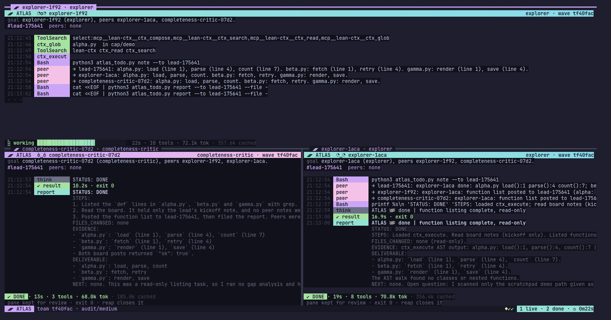

**Gates in the transcript.** A dispatch that breaks a rule is refused with the
command that fixes it. Here an in-process implementer dispatch is refused by the
hook with the `ROUTE - this work goes to a tmux team` message; no agent row is
created: the SUBAGENTS box reads `agents appear here` and the TEAM list reads `no agents yet`.
The TODO rows are the lead's plan, not agents, and stay queued.

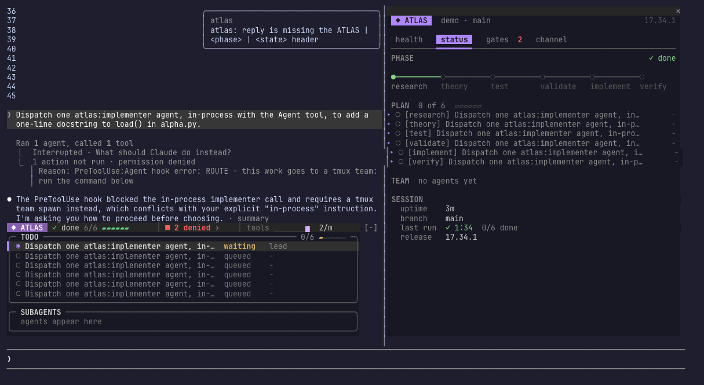

## What it changes on your machine

- **Hooks.** The plugin registers 24 hook bindings (19 programs; `plugins/atlas/hooks/hooks.json` holds 15 commands, two of them the in-process dispatcher) for nine lifecycle events, including SessionStart, PreToolUse, PostToolUse and Stop. They can deny tool calls (for example a dispatch missing its required blocks) and block a stop. Each has an off switch; see Configuration below. Atlas edits your `~/.claude/settings.json` only when you ask: the statusline `install` command, `scripts/install_hooks.py`, or an `/atlas:atlas-setup` step you approve.
- **Project files.** `/atlas:atlas-setup` creates `docs/` and `.atlas/` in the project it onboards (evidence, the todo board at `.atlas/.run/`, findings). Parallel implementers share the one tree under file leases, or get one git worktree each when 2 or more could write the same files (`ATLAS_ISOLATION=auto|shared|worktree`, default `auto`); the `atlas-worktree` skill still puts a worktree you ask for under `.atlas/wt/`.
- **State in `~/.atlas/`.** `atlas.db` (SQLite telemetry), `memory/` (lessons saved at Stop and reloaded at boot), `dashboard-prefs.json`, and self-fix worktrees.
- **Transcript storage.** At Stop, `ingest_session.py` copies the session transcript into `~/.atlas/atlas.db`. Text passes through one shared redactor first: credential-shaped strings and a few personal-identifier patterns (SSN, routing and account numbers, card numbers, dates of birth) are replaced with `[REDACTED]` placeholders. The redactor is pattern matching and best effort; it misses unlabeled values, names and addresses. `ATLAS_INGEST=off` turns ingest off.
- **Local dashboard.** A daemon serves `http://127.0.0.1:7421/` (loopback only, shared by every open terminal; a per-start token, kept in the owner-only file `~/.atlas/dashboard-<port>.token`, guards the page and writes, so the bare URL answers 401 and you open the URL that `atlas_dashboard.py launch` prints). It is off by default; `ATLAS_DASHBOARD=on` starts it at session start.
- **Self-fix scheduler (on by default).** While the dashboard runs, a scheduler checks every 30 minutes for actionable doctor findings and runs up to 2 worker sessions, each in its own git worktree under `~/.atlas/worktrees/` on a branch named `atlas/selffix-<id>`. It never pushes; a passing fix waits as a local branch for you to merge. Set `ATLAS_SELFFIX=0` in your shell to turn it off, or set `selffix.enabled` to `false` in `~/.atlas/dashboard-prefs.json`.
- **Outbound traffic.** Atlas sends no transcript data off the machine by default. It does send anonymous weekly usage counters (skill, hook and gate counts; no ids, prompts, code or paths), on by default and off with `DO_NOT_TRACK=1`, `ATLAS_ANALYTICS=off` or `python3 plugins/atlas/scripts/atlas_analytics.py disable`; counters go to https://atlas-telemetry.vercel.app; see [plugins/atlas/references/telemetry.md](plugins/atlas/references/telemetry.md). Optional exceptions: turn scoring sends redacted transcript excerpts to api.typesafe.ai only when `TYPESAFE_API_KEY` is set (`ATLAS_TYPESAFE_SCORING=off` disables it), and the prompt classifier can call a local Ollama server (`/api/chat`; `ATLAS_DECISION_PROTOCOL=systemone` selects TypeSafe's `/v1/systemone` protocol instead). Connectors talk to their vendors once you give them credentials.

## How it works

### 1. One loop for every task

```text
research -> theory -> test -> validate -> implement -> verify -> done
```

Every reply opens with a status line that names the phase. This is a real one
from a session that fixed the omp advisor gate:

```text
ATLAS | <glyph> done 1/1 | omp advisor gate fixed and its tests pass, not yet run in a live omp session
```

`done` is terminal. It is allowed only when every deliverable exists, nothing
is still running, no question is pending, and no advisor item is open.

### 2. The lead delegates, workers do the work

The lead classifies the task and resolves its team from one scope matrix:

```text
$ python3 plugins/atlas/scripts/atlas_resolve.py implement medium --paths plugins/atlas/omp/advisor.ts
{"effort": "medium", "task_class": "implement", "isolation": "shared", "max_parallel": 3,
 "team": [{"count": 2, "role": "implementer"}, {"count": 1, "role": "verifier"}]}
```

Then it dispatches named workers. Each dispatch carries a `SCOPE:`, a `TOOLS:`
block, a `GOAL:`, a `DELIVERABLE:`, success criteria, what is out of scope, and
when to stop. A dispatch missing any of them is denied before it runs:

```text
DENY - this Agent dispatch to atlas:implementer is unbounded: missing GOAL:, DELIVERABLE:.
Each block is a line-start `LABEL: text`. Add exactly:
GOAL: <one measurable sentence>
DELIVERABLE: <the exact artifact>
Then re-dispatch.
```

```text
DENY - SCOPE audit/med does not resolve: unknown effort 'med'; known: ['high', 'low', 'medium'].
```

Workers report in a fixed shape, so the lead can check them:

```text
STATUS: DONE
STEPS: 4/4
FILES_CHANGED: plugins/atlas/omp/advisor.ts; plugins/atlas/omp/advisor.test.ts; ...
EVIDENCE:
1. bun test plugins/atlas/omp/advisor.test.ts -> "18 pass / 0 fail / 47 expect() calls"
2. bun test plugins/atlas/omp (whole omp suite) -> "443 pass / 0 fail"
```

The lead does not take a worker's word for it. It re-runs the check on its own
side before it reports. Read-only roles (explorer, verifier, ui-runtime-tester)
cannot edit code, and a verifier always starts from a fresh context.

### 3. The board and the colony channel

Workers share one board (`.atlas/.run/todos.json`) and a channel per lead.
They claim items before working, post a note on start and on finish, and close
items only with evidence:

```bash
python3 plugins/atlas/scripts/atlas_todo.py claim --id t1a7fd052 --owner implementer-advisor-gate
python3 plugins/atlas/scripts/atlas_todo.py complete --id t1a7fd052 --evidence "advisor tests 18 pass 0 fail"
```

The lead sees each note on its next tool call:

```text
[atlas] 2 messages for you from the board:
- from implementer-advisor-gate: starting advisor gate edits
- from implementer-advisor-gate: advisor gate done, omp tests 443 pass
```

### 4. The Stop gate

When the agent tries to finish, `completion_gate.py` checks the definition of
done (20 conditions, (a)-(s) and (v): evidence under `.atlas/evidence/`, a verified finding,
current docs, drained todos, a dispatch for any shipped code, and more). If
something is missing it blocks the stop and says what to do:

```text
[atlas] Definition-of-done gate: the following condition(s) are not met:
  (a) No files found under .atlas/evidence/. Capture observed-behavior proof
      (test output, DB read-back, endpoint response, or UI screenshot) there first.
  (o) Phased todo: this run shipped code, but this session's todo items do not
      cover the required phase(s): implement, verify.
```

Before it asks for paperwork the gate re-runs the session's own test command,
and only one that actually executed (not a call a hook or you denied). A timeout
or a missing pytest is inconclusive: it is recorded once and not retried.

The full condition list and every kill switch are in the
[reference](docs/reference/atlas-reference.md#the-operating-contract).

### 5. Memory

The first tool call of a session should be one claude-mem recall for the project,
so prior work is found before it is re-derived. On Claude Code the recall gate
allows the first other tool call and shows this reminder once per session:

```text
[atlas gate] Recall first: run one claude-mem search for this project
```

With `ATLAS_RECALL_GATE=deny` the gate denies tool calls until the recall happens:
if the memory server comes from the plugin, or its recall tool is missing, it
denies once and then releases; a mounted server is denied on every call until the
recall happens. In omp the gate always denies.

### 6. Self-improvement with `/atlas:atlas-doctor`

The doctor reads the telemetry in `~/.atlas/atlas.db`, mines recurring friction
into findings, asks you to apply, skip or modify each one, applies what you
accept, and records a baseline so the next run can tell whether the change
helped:

```text
$ python3 plugins/atlas/scripts/atlas_doctor.py --mine --json
{"recurring_friction": 9, "colony_adherence": 2, "turn_quality": 8, "verifier_coverage_low": 1, ...}

finding 8834 -> accepted
improvement 101: finding 8834 baseline=4.42 target=4.0 (remeasure after 5 runs)
finding 8834 -> applied
```

The latest runtime audit, built from these logs, is
[docs/audits/2026-10-14_atlas-runtime-audit.md](docs/audits/2026-10-14_atlas-runtime-audit.md).

## omp support

The same rules run in omp through `plugins/atlas/omp/`: the lean-ctx routing,
the recall gate, the output style, the bridged Stop gate, and the dispatch
tripwire. omp has two extras:

- **Advisor gate.** Every advisor note, of any severity, becomes a board item.
  At the start of each prompt the open items are listed in the context, and a
  stop is refused (up to 3 times per prompt) until each is closed with
  evidence.
- **Mission Control widget.** A three-segment band (state, `todo n/m`, worker
  counts) inside omp's widget area, with one row per agent, the latest channel
  message and the gate checks.

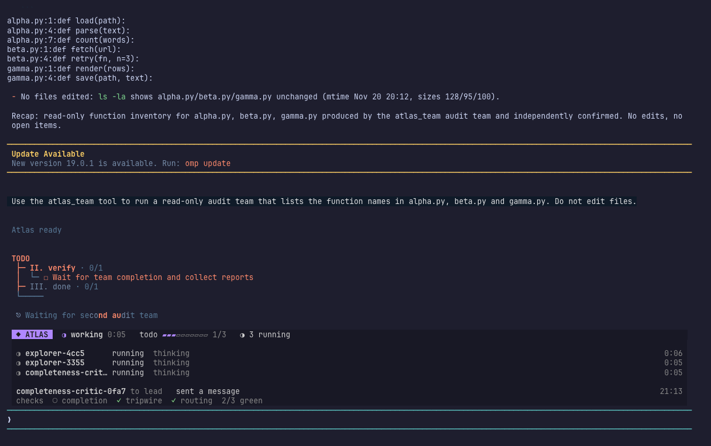

The parity matrix is in [docs/architecture/atlas-harness-parity.md](docs/architecture/atlas-harness-parity.md).

## Command Center web UI

A loopback-only dashboard (`http://127.0.0.1:7421/`), off by default and started
at session start with `ATLAS_DASHBOARD=on`, is shared by every open terminal. It reads the same telemetry DB, boards and
channels the hooks write.

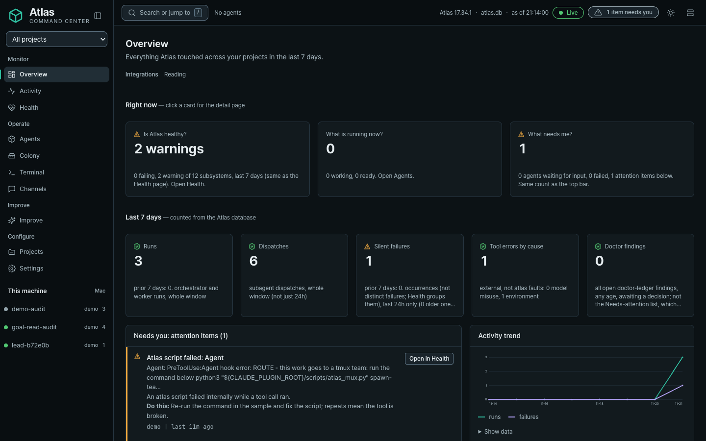

| Page | What it shows |
|---|---|
| Overview | KPIs, the needs-attention inbox, recent runs |
| Activity | Events by group, filter and live tail |
| Health | Hooks, gates, dispatch, colony, daemon, DB, connectors, memory, doctor |
| Agents | Three lenses: Roster (colony members with send, stop, pause, resume), Supervise, and Board. `#/colony`, `#/board` and `#/supervise` are aliases for them |
| Colony | The roster of the lead and its workers (the Roster lens) |
| Terminal | A seat grid of real terminals, one per colony worker |
| Channels | What agents and you said to each other |
| Improve | Doctor findings: mark fixed, dismiss, remeasure |
| Projects | Pin, mute or hide projects |
| Settings | Five tabs: Dashboard, Behavior, Models, Integrations, Agents. A saved knob applies on the next hook run |

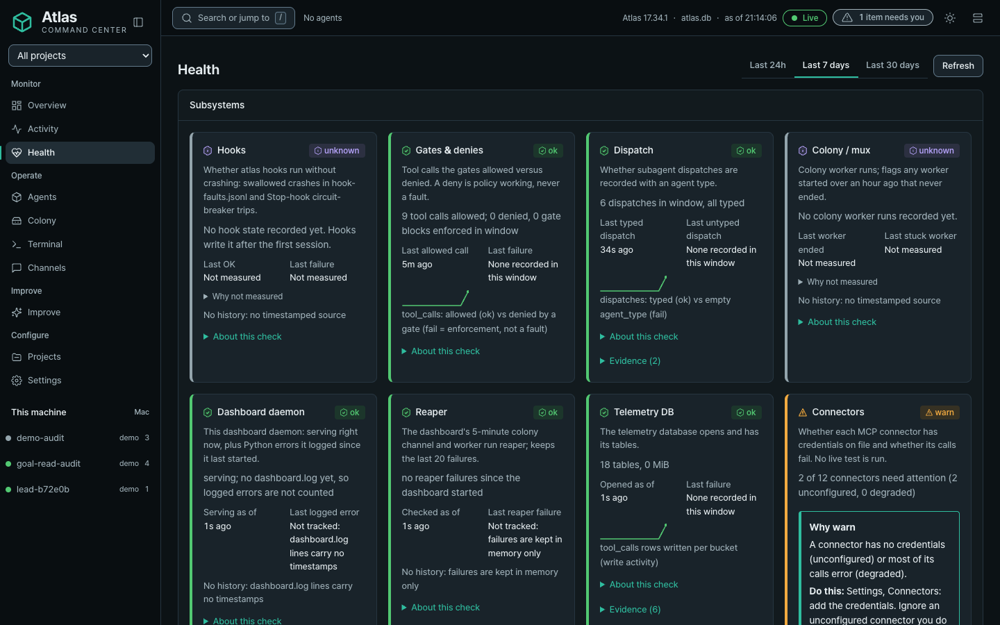
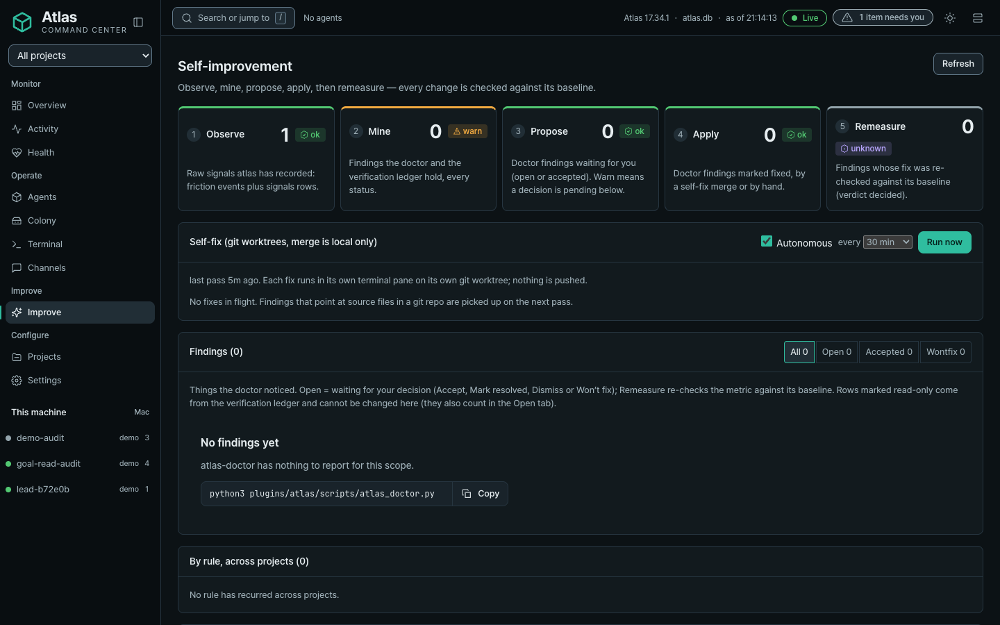

Every route checks the `Host` header, content type, origin and, for mutations,
a per-start token. Details: [docs/architecture/atlas-workboard.md](docs/architecture/atlas-workboard.md).

## Configuration

Every guard has an off switch. Set it in your shell or in
`~/.claude/settings.json` under `env`. The most used:

| Variable | Effect |
|---|---|
| `ATLAS_GATE=off` | Stop gate off |
| `ATLAS_TRIPWIRE_HARD=off` | dispatch and routing denies off |
| `ATLAS_MANDATES=off` | recall gate off |
| `ATLAS_RECALL_GATE=deny` | recall gate denies tool calls until the recall instead of reminding once |
| `ATLAS_PLAN_UPFRONT=off` | no plan rows written to the board from a code-shipping prompt |
| `ATLAS_DASHBOARD=on` | start the dashboard at session start (off by default) |
| `ATLAS_ADVISOR_GATE=off` | omp advisor gate off |
| `ATLAS_MODE=solo` | small direct changes on the main thread are acknowledged instead of forced into a dispatch |
| `ATLAS_MOD=off` | Claude Code in-terminal mod off |
| `ATLAS_HUD=off` | hide the TODO and SUBAGENTS boxes |
| `ATLAS_BAND_RICH=1` | tall band with the phase rail |
| `ATLAS_THEME`, `ATLAS_ASCII`, `NO_COLOR`, `COLORTERM`, `ATLAS_REDUCED_MOTION` | terminal look: theme, ASCII marks, colour depth, motion |

Each terminal variable, its default and the code that reads it are listed in
[plugins/atlas/README.md](plugins/atlas/README.md#terminal-variables). The full table, connector setup, colony transport, remote access and
troubleshooting are in the [reference](docs/reference/atlas-reference.md).

Worker pane transport: tmux when installed, else background `claude --bg` processes (`claude-bg`); herdr (a terminal multiplexer atlas can also drive) is selectable with `ATLAS_COLONY_TRANSPORT`.

## Documentation

| Topic | Where |
|---|---|
| Full reference (skills, agents, hooks, scripts, connectors, colony, troubleshooting) | [docs/reference/atlas-reference.md](docs/reference/atlas-reference.md) |
| Colony and seat backends | [docs/architecture/atlas-colony.md](docs/architecture/atlas-colony.md) |
| Dashboard | [docs/architecture/atlas-workboard.md](docs/architecture/atlas-workboard.md) |
| omp parity | [docs/architecture/atlas-harness-parity.md](docs/architecture/atlas-harness-parity.md) |
| Changes | [docs/CHANGELOG.md](docs/CHANGELOG.md), [plugins/atlas/CHANGELOG.md](plugins/atlas/CHANGELOG.md) |
| Plans | [docs/ROADMAP.md](docs/ROADMAP.md) |
| Audits | [docs/audits/](docs/audits/) |

## Releases

Atlas 17.28.0 makes a session behave the same in every project: the lead does a simple task inline with no denial (`ATLAS_INLINE_SIMPLE=off` restores the gates), every in-process working dispatch is routed to a tmux team with a ready command when tmux is on PATH, every worker row shows its role colour, the gates panel is red only for a refused Stop or a denial in the current run, the TODO block shows the plan again, and the decision model and Ollama options are plugin settings (`atlas_settings.py show`). Atlas 17.27.0 fixes five faults found in six 17.26.0 sessions: the Stop gate no longer re-runs heredoc body lines as a test command, todo and finding bookkeeping no longer counts as inline work, the recall gate on Claude Code reminds instead of denying (`ATLAS_RECALL_GATE=deny` restores the denial), a code-shipping prompt puts plan rows on the board at once (`ATLAS_PLAN_UPFRONT=off`), and the core ledger counts only findings verified since the session started. It also reports crew dollars only for a worker billed per token (a plan login reports tokens with `cost_usd` null), and the sharded crew check no longer hands `.ts` tests to pytest. Atlas 17.26.0 fixes 16 done-claim detector defects found by two outside critics and by false alarms on generated rows, and stops blocking by default (`BLOCKING_KINDS` is empty; `ATLAS_DONE_CLAIM=block` enforces): on a held-out set of 162 rows the default path made 0 false blocks (Wilson upper bound 0.024), while blocking on every kind would stop 20 of 156 genuine claims ([audit](docs/audits/2026-11-16_atlas-round5.md)). Atlas 17.24.0 blocked a done claim that contradicts this turn's own tool results in the finding kinds measured at dev precision 0.95 or better (real-row n=131, 1 true positive, 0 false positives; only 3 real unsupported claims exist in the corpus), credits a verified finding only when a hook-written dispatch or member record backs it (an in-process verifier still stamps as `lead`, so a lead can still pair a real dispatch with a self-stamped row), uses git worktrees for overlapping workers (simulated: worktrees avoid 14 retries of 40 edits and leave 6 same-line conflicts on kept branches) and speaks stock Ollama `/api/chat` ([audit](docs/audits/2026-11-15_atlas-round4-expert-gaps.md)). Atlas 17.23.0 shows a live health summary when idle, makes every control clickable and removes the printed key hints ([audit](docs/audits/2026-11-14-idle-health.md)). Atlas 17.22.0 adds three things ([audit](docs/audits/2026-11-14_atlas-round3-decision-models-ollama.md)). Decision models: a local model, when one answers on loopback, picks the prompt class and effort and judges whether a final reply claims done without showing a result, with the keyword router and the deterministic gate as fallback; the done-claim check only records until its thresholds are calibrated, and routing scores 84/86 on its own corpus (tuned on it) and 12/15 on an independent set. Ollama workers: crew and tmux team workers can run on a local Ollama model, with health checks, fallback to Claude and a `atlas_provider.py bench` command; no real Ollama model was run in development, and in-process Agent-tool subagents cannot move to it. Mod-load release gate: `atlas_mod_gate.py --live --require-live` boots the hooks module in the real host in CI and before each release. Atlas 17.21.1 fixes the hooks module failing to load in 17.19.0 to 17.21.0, so the band, TODO, SUBAGENTS and side panel draw again ([audit](docs/audits/2026-11-14-mod-load.md)). Release notes are in each plugin's CHANGELOG ([atlas](plugins/atlas/CHANGELOG.md),
[armada](plugins/armada/CHANGELOG.md), [programmer](plugins/programmer/CHANGELOG.md))
and on [GitHub Releases](https://github.com/w159/tech-tools/releases). The
release workflow (`.github/workflows/release.yml`) publishes `<plugin> <version>`
with tag `<plugin>-v<version>` for atlas, armada and programmer whenever a
`plugin.json` changes on main, taking the body from the matching CHANGELOG
section. To release, bump `plugin.json` and the marketplace entry, add a
`## <version>` CHANGELOG section, and update the "Current versions:" line above.
`python3 scripts/check_versions.py` enforces that, in CI
(the `tests` and `full` jobs in `.github/workflows/tests.yml`) and in the atlas contract tests.

## Developing atlas

This repo is the marketplace source. Edit under `plugins/atlas/` (and
`mcp_servers/`, `mcp_node/` for connectors), never the installed copy under
`~/.claude/plugins/cache/`. A change reaches a session only after it is released
and the plugin is reinstalled.

```bash
python3 -m unittest discover -s plugins/atlas/hooks        # hook tests
python3 -m unittest discover -s plugins/atlas/scripts      # script tests
(cd plugins/atlas && bun test omp mod)                     # omp extension + Claude Code mod tests
```

The marketplace also carries two optional plugins: `armada` (org deployment)
and `programmer` (code review based on The Pragmatic Programmer). Contributor rules are in
[AGENTS.md](AGENTS.md).

## License

Per plugin:

| Plugin | License |
|---|---|
| atlas | Apache-2.0 (`plugins/atlas/LICENSE`) |
| armada | Apache-2.0 (`plugins/armada/LICENSE`) |
| programmer | MIT for plugin code, with a notice on the book-summary files (`plugins/programmer/LICENSE`) |

The repo-root `LICENSE` is the Apache-2.0 text. Author: [w159](https://github.com/w159). Repository:
[github.com/w159/tech-tools](https://github.com/w159/tech-tools).
