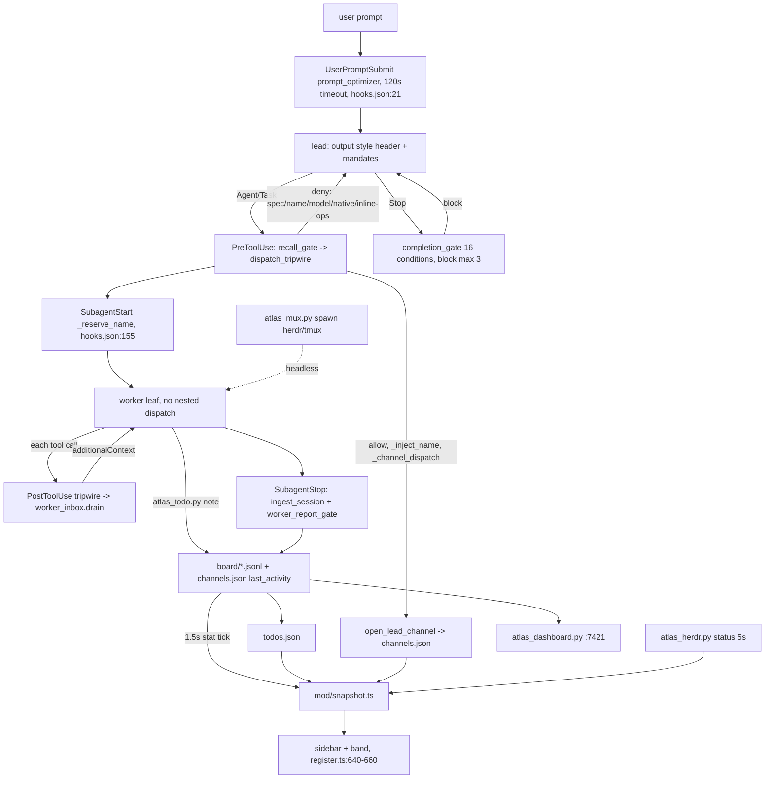

# Atlas orchestration audit — command center, health, colony, IRC, mux

Audit date 2026-10-13. Plugin `plugins/atlas` 11.1.7, HEAD 00592fa1. Read-only. Paths relative to `plugins/atlas/` unless prefixed `docs/` or `.atlas/`. Target path for this file: `docs/audits/2026-10-13_orchestration-audit.md` (the explorer role cannot write file paths; lead must move this file there).

Verification limits: nothing run against a live session. Hook latencies timed once with a `/tmp` cwd (no `docs/`): lower bound. **[INFERENCE]** marks unobserved claims.

## 1. Component map

### 1.1 Command center (mod sidebar + `/atlas-cc`)
- Entry: `mod/register.ts:579` registers `/atlas-cc` (no `argumentHint`); handler `:669` (sets `paneOpenedState`, opens pane focused); close `:677`. `/atlas-say` `:580,683`, `/atlas-todo` `:581,698`. Render hooks: `AbovePrompt` band `:640` (`mod/band.tsx`), `Pane` sidebar `:648` (`mod/pane/sidebar.tsx`: route, tasks per phase, team + message field, gates; helpers `sidebar-route|team|gates.tsx`).
- Reads: `.atlas/.run/todos.json` (`mod/data/todos.ts:60`), `channels.json` (`mod/data/channels.ts:122`), `board/*.jsonl` w/ byte cursors (`channels.ts:52-63`), `findings.json` (`mod/snapshot.ts:156`). Shells: `atlas_herdr.py status` every 5 s after pane opened (`register.ts:420-426`), `atlas_wt.py status`, `atlas_mux.py status` (`mod/data/sessions.ts:123`), `atlas_gates.py` (`register.ts:63`).
- Writes: `/atlas-say` -> board note, `/atlas-todo` -> todo, both via `scripts/atlas_todo.py`.
- Change detection: 1.5 s tick stats todos/channels/findings (`register.ts:266-267,410`).
- Docs: `docs/architecture/atlas-mod.md` (2026-10-12), `README.md:258`.

### 1.2 Health (atlas-doctor + dashboard)
- Skill `skills/atlas-doctor/SKILL.md` (6 phases enrich->mine->decide->apply->measure->refresh; deterministic work delegated to `atlas_doctor.py`, SKILL.md:21-26).
- `scripts/atlas_doctor.py` 3067 lines: `main :2759`; `--fix`, `--hook` (`:2761-2766`), `--purge`, `--list-findings :2888`, `--baseline :2919`. Checks: wiring `:205`, output style `:238`, omp roles `:278`, omp bridge `:416`, content drift `:527`, cmux `:580,604`. SessionStart runs `--hook` after `session_boot.py` (`hooks.json:4-20`); always exits 0 (`atlas_doctor.py:11`), persists verdicts (`:1067`).
- Data: `atlas.db` (findings, facets, asset_verdicts), `.atlas/.run/findings.json`.
- Dashboard: `scripts/atlas_dashboard.py` 2985 lines (`serve :2898`, `main :2925`, loopback :7421), started detached by `hooks/session_boot.py:20 ensure_dashboard` (15 s budget `:83`). Backends `atlas_dash_{work,irc,herd,colony,insights}.py`, `atlas_health_collect.py`; SPA `scripts/dashboard_ui/{js,css}`; routes `atlas_dashboard.py:2581-2860`.
- Mod link: none. Mod never reads doctor output or the dashboard; health reaches the user only as the SessionStart warning.

### 1.3 Orchestration (colony, agents, gates)
- Colony: `colony/herdr` (LICENSE/NOTICE/PIN.json), `colony/herdr-web-ui` (vendored Bun UI); glue `scripts/atlas_herdr.py` (1205 lines; ensure `:976`, status `:841`, create_pane `:659`); booted detached by `session_boot.py:128 ensure_colony`. `docs/architecture/atlas-colony.md` verified against 10.4.3 (two majors stale).
- Agents: `agents/*.md` x13; omp copies via `omp/gen-agents.ts`.
- Dispatch gate `hooks/dispatch_tripwire.py` (2089 lines): `main :1771`, `_run :1898`, `_pre_tool_use :970`, `_native_tool_policy :1520`, `DENY_THRESHOLD = 6`, `_channel_dispatch :1668`, `_is_worker :1150`, nested-dispatch deny `:182`.
- Done gate `hooks/completion_gate.py` (2268 lines): `main :1260`, 16 conditions, blocks `:1313,:1397`, `BLOCK_LOOP_LIMIT = 3` `:1502`.
- Worker report: `hooks/worker_report_gate.py` (SubagentStop, `hooks.json:167-180`).
- Data: `todos.json` (1488 items: 1471 completed, 16 pending, 1 in_progress), `findings.json`, `channels.json`, `board/*.jsonl`, `inbox/<worker>.json`, `native_nudges/`, `spec_denies/`, `autonames/`, `atlas-orchestrate.active`, `dirty-snapshot-*.json`.

### 1.4 IRC / channel layer
- `scripts/atlas_todo.py` 1796 lines: `note :749`, `notes :809`, `claim_paths :911`, `main_channel :1049`, `open_lead_channel :1141`, `join :1170`, `mark_finished :1212`, `get_channel :1308`, `may_post :1351`, `default_channel :1372`, `register_member :1416`, `channel_brief :1471`, `channel_board :1512`; lock `_locked_load :229`.
- Delivery `hooks/worker_inbox.py` (`context_for_post_tool_use :368`), called from tripwire PostToolUse (`dispatch_tripwire.py:1802-1806`): **every PostToolUse call pays an inbox drain**. omp: `omp/channels.ts`, `omp/channel-view.ts` via `omp/hook-bridge.ts`.
- State: `channels.json` 94 KB, 30 channels (29 lead + 1 main), 497 member entries (git-ignored `.gitignore:262`); `board/` 246 files 1.1 MB; `inbox/`.
- Dashboard `atlas_dash_irc.py` (646 lines). Docs `docs/architecture/atlas-channels.md`, `atlas-workboard.md` (both pre-11.x).

### 1.5 Mux (`scripts/atlas_mux.py`, 1145 lines)
- `main :1131`, `transport :187`, `pane_env :266`, `cmd_spawn :633`, `cmd_run_worker :753`, `_classify :743`, `_report :861`, `cmd_status :892`, `cmd_kill :1003`.
- Data: `.atlas/.run/logs/<worker>.log` (60 KB), one `kind=report` note per worker, membership in `channels.json`.
- Mod: `mod/data/sessions.ts:123` parses `status`; unknown transport falls back to `claude-bg` (`:100`).
- Pitfall (memory 2026-10-09, **[INFERENCE]** unre-checked): spawn needs `ATLAS_MUX=tmux`; `kill` defaults to herdr even after tmux fallback.

## 2. Flow

Two independent renderers of one board (mod vs dashboard), sharing no code.

## 3. Defects

### 3.1 Dead / stale
1. `/atlas-cc` tab argument documented (`CHANGELOG.md:109` says hint at `register.ts:442`) but `register.ts:579` has none and the five tabs are gone (`mod/pane/chrome.tsx` is 14 lines). `README.md:258` and `docs/architecture/atlas-mod.md` disagree.
2. Tracked stray `mod/band.tsx-E` (BSD sed backup) is committed.
3. `docs/architecture/atlas-colony.md`, `atlas-channels.md`, `atlas-workboard.md` verified at 10.4.3 or earlier; plugin is 11.1.7.
4. `.atlas/.run` is 32 MB: 259 `dirty-snapshot-*.json` (7.4 MB), 246 board files, ad-hoc artifacts (`panos-*.json`, `vd-*.webp`, `verify-*.webp`, `vacuous-check.mjs`, `live-mod-cc3.txt`). No pruning.
5. `todos.json` append-only in practice (1488 items); reloaded whole under lock per op (`atlas_todo.py:229`), re-parsed by mod (`todos.ts:60`).
6. Advisor advisories arrive as new pending IDs each wave and must be closed by CLI; 16 pending now.

### 3.2 Duplicated state
- Roster/channel state in `channels.json`, `board/*.jsonl`, `inbox/<worker>.json`, atlas.db, herdr panes, `omp/channels.ts`; each consumer reads a different subset.
- Stuck threshold: `atlas_dash_colony.py` STUCK_S 15 min vs `mod/data/herdr.ts:18`.
- Native-tool policy in `contracts/native-tools.json`, `dispatch_tripwire.py:1345-1580`, `omp/index.ts` (`ATLAS_NATIVE_POLICY=off`, tripwire `:1520`).
- Recall mandate twin: `hooks/recall_gate.py` vs `omp/mandates.ts`.
- Mod vs dashboard renderers.

### 3.3 Gate friction ("wrecked")
Counts from `hooks/hooks.json` (13 event/matcher groups, 22 hook entries):

| Layer | Gate | Deny? | Cite |
|---|---|---|---|
| every tool (`*`) | recall_gate.py | **deny on every attempt** until a claude-mem call | `hooks.json:33-42`, `recall_gate.py:3-6` |
| Edit/Write/Read/Grep/Glob/Bash/Agent/Task | dispatch_tripwire Pre | deny | `hooks.json:60-68` |
| same + Skill | dispatch_tripwire Post | STOP nag + inbox drain | `hooks.json:94-103` |
| Bash | bash_advisor | advisory | `hooks.json:45-50` |
| Bash | fallow_gate | deny `git commit/push` (300 s) | `hooks.json:51-56` |
| Edit/Write | format_after_edit (async), docs_drift_watch, delegation_prewarn | advisory | `hooks.json:81-101` |
| atlas/connector MCP | connector_credential_watch | advisory | `hooks.json:104-112` |
| each prompt | prompt_optimizer (120 s) | rewrites | `hooks.json:21-31` |
| Stop | completion_gate + ingest_session, chronicle_facet, memory_capture, nudge | block <=3x | `hooks.json:123-152`, `completion_gate.py:1313,1397,1502` |
| SubagentStop | ingest_session, worker_report_gate | block malformed report | `hooks.json:167-180` |

Tripwire deny classes (>=10): nested dispatch `:182`; built-in agent `:983-995`; missing spec/toolkit/name/model/runner-steps `:970-1100`; inline target-code edit `:1104`; 7th inline op `:1131`; transient DB `:1140`; native Grep/Glob in `docs/` projects `:1543`; exploration-only Bash `:1571`; device-args overwrite `:1875`. Read and Bash also get one nudge per session. 5 deny-capable programs (recall_gate, tripwire, fallow_gate, completion_gate, worker_report_gate), >=8 advisory injectors.

User experience:
1. Denied native tools: this audit's own plain `bash cat/grep` was refused ("only reads files, so use lean-ctx ctx_shell"); this explorer's `write` to a file path was also refused (explorer.md disallows Write). Native Grep/Glob hard-denied in any `docs/` project; replacement reachable only after ToolSearch; recall_gate denies everything until claude-mem is called.
2. Inline edits denied once the session is flagged (first `atlas:` dispatch flags it): `dispatch_tripwire.py:1104`.
3. Repeated nags: tripwire Post, delegation_prewarn every 5th drifting edit, docs_drift_watch per edit, inbox drain.
4. Stop stacking: 5 hooks serial (timeouts 60+60+30+30+15) plus up to 3 blocks.
5. Status header missing: style `output-styles/atlas-orchestrator.md:14-18`, `force-for-plugin: true`; `~/.claude/settings.json:799` has `"outputStyle": "Atlas Orchestrator"`. **[INFERENCE]** Claude Code namespaces plugin styles `<plugin>:<name>`, so the bare name may resolve to nothing; unverified. `plugin.json` has no output-style key (relies on dir discovery). Under omp, `omp/style.ts` (appended at `omp/index.ts:728`) returns undefined silently if `contracts/tool-names.json` fails or `ATLAS_STYLE=off`. `atlas_doctor.py:238 check_output_style` only warns at SessionStart, exit 0.
6. Mod noise: band + sidebar always on, polling 1.5 s / 5 s, spawning Python CLIs; fed by a 1488-row todos file.

## 4. Every tool call: gates and cost
Timed once, /tmp cwd (lower bound): bare python ~22 ms, recall_gate ~36 ms, dispatch_tripwire ~49 ms (Pre and Post).

| Tool | Hook procs | Cost |
|---|---|---|
| Read/Grep/Glob | recall_gate + tripwire Pre + Post = 3 | ~135 ms |
| Bash | recall + bash_advisor + fallow_gate + tripwire Pre + Post = 5 | >=200 ms; fallow audit <=300 s on commit/push |
| Edit/Write | recall + tripwire Pre + format(async) + docs_drift + delegation_prewarn + tripwire Post = 6 | ~250 ms |
| Agent/Task | recall + tripwire Pre (spec parse, naming, DB, channel open under lock) + SubagentStart + Post | >=150 ms |
| atlas/connector MCP | recall + connector_credential_watch | ~70 ms |
| each prompt | prompt_optimizer (Ollama, <=120 s) | model-dependent |
| each Stop | 5 hooks; completion_gate 2268 lines, 16 conditions, DB+git | seconds **[INFERENCE]** |

In real `docs/` repos tripwire also reads native-tools.json, `.mcp.json`, Claude settings (`_lean_ctx_server_key :1284`) and atlas.db: higher. Under omp each is spawned via `omp/hook-bridge.ts` (25 s cap, `:405`). Tripwire (2089 lines) is registered twice and re-imported per call; every injection lands in model context.

## 5. What a good version needs
1. One state authority: a single board store (notes, channels, todos, roster) behind one reader used by mod, dashboard, inbox, mux; prune/archive completed todos and snapshots at boot.
2. Gates that deny rarely and say how to proceed: collapse ~10 tripwire denies to structural ones (nested dispatch, malformed spec, git push); recall mandate once per session; inline-op and docs-scope denies become one end-of-turn note; never deny a tool the model cannot yet reach.
3. One resident hook daemon or one merged hook per event: not 3-6 Python cold starts per call; cache settings/contracts; inject only when there is something to say.
4. A command center that shows the lead orchestrating: dispatch -> worker -> channel-note rows (live tail, blocked, reported), shared stuck threshold, `/atlas-cc <tab>` restored or docs corrected; one snapshot feeding mod and dashboard.
5. Visible self-checking health: doctor verifies the output style actually applied (header in first reply), shows a one-line verdict in the band, fails loudly when style/hooks do not load; colony/channels/workboard docs carry a version-drift check.
